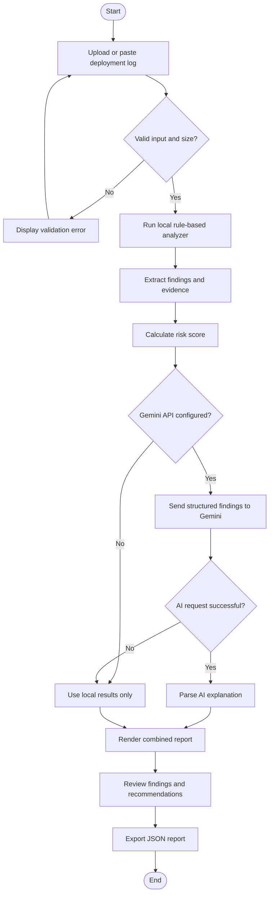
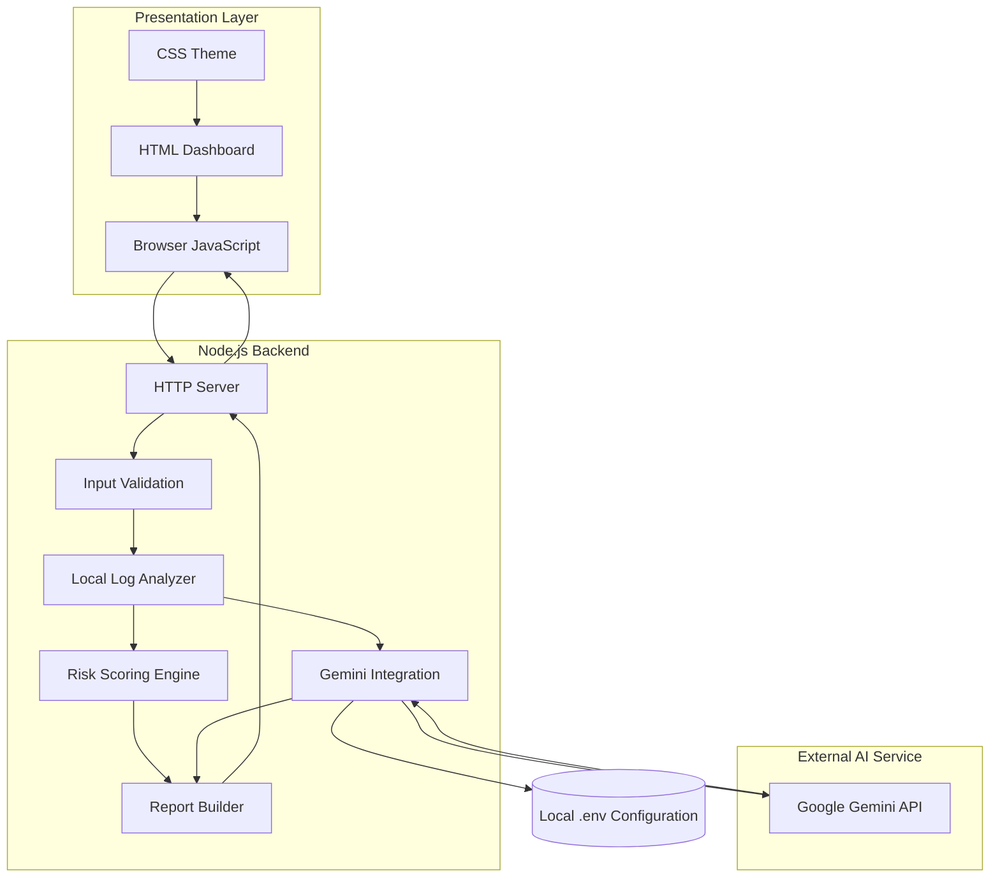
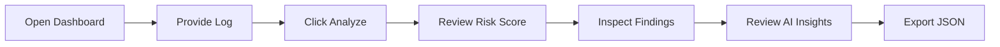

# ReleasePilot AI 🚀
### AI-Powered Deployment Diagnostics for Copado Release Workflows

**Identify deployment blockers. Understand likely root causes. Ship with greater confidence.**

ReleasePilot AI is an AI-assisted deployment-log diagnostics platform that combines deterministic log analysis with Google's Gemini API to help developers identify common deployment failures, assess potential release risk, and receive actionable troubleshooting recommendations.

It provides an interactive web dashboard where users can upload or paste deployment logs, inspect detected issues, review a risk score, and explore AI-generated explanations in one place.

> **Project status:** Hackathon prototype. Local deployment-log analysis and Gemini AI explanations are implemented. A live Copado or Salesforce deployment connection is not currently implemented.

---

## Table of Contents

- [Overview](#overview)
- [Problem Statement](#problem-statement)
- [Our Solution](#our-solution)
- [Key Features](#key-features)
- [How It Works](#how-it-works)
- [System Architecture](#system-architecture)
- [Application Workflow](#application-workflow)
- [Risk Scoring](#risk-scoring)
- [Technology Stack](#technology-stack)
- [Project Structure](#project-structure)
- [Getting Started](#getting-started)
- [Environment Configuration](#environment-configuration)
- [Using the Dashboard](#using-the-dashboard)
- [API Documentation](#api-documentation)
- [Testing](#testing)
- [Security and Privacy](#security-and-privacy)
- [Limitations](#limitations)
- [Future Roadmap](#future-roadmap)
- [Contributing](#contributing)
- [License](#license)

---

## Overview

Software deployment failures can involve missing components, failed automated tests, permission problems, dependency issues, or timeouts. Investigating these failures manually can slow down development and release workflows.

ReleasePilot AI helps developers make sense of deployment logs through two complementary approaches:

- **Rule-based diagnostics:** identifies predefined error patterns, extracts relevant evidence, and calculates a deterministic risk score.
- **Gemini AI analysis:** interprets detected findings and generates likely root causes, recommended actions, and verification caveats.

The result is a unified diagnostic report that combines predictable local checks with AI-assisted troubleshooting.

### Project at a glance

| Attribute | Details |
|---|---|
| Project name | ReleasePilot AI |
| Category | AI / Developer Tools / DevOps |
| Application type | Web-based diagnostic dashboard |
| Backend | Node.js built-in HTTP server |
| Frontend | HTML, CSS, JavaScript |
| AI provider | Google Gemini API |
| Analysis mode | Local log analysis + optional AI analysis |
| Input formats | Pasted text, `.log`, `.txt` |
| Maximum input size | 1 MB |
| Output | Risk assessment, findings, recommendations, JSON report |
| Copado integration | Not yet implemented |

## Problem Statement

Deployment troubleshooting can be time-consuming when developers must manually inspect large or complex logs to identify the errors preventing a successful release.

Common challenges include:

- Finding important errors among informational messages.
- Identifying missing metadata or components.
- Investigating automated test failures.
- Understanding deployment timeouts and dependency errors.
- Prioritizing issues that may affect release readiness.
- Translating technical log messages into actionable next steps.

A lightweight diagnostic tool can help organize this information and reduce the effort needed to begin an investigation.

## Our Solution

ReleasePilot AI combines a local diagnostic engine with an AI-assisted explanation layer.

1. Developers provide a deployment log.
2. The local analyzer scans it for supported error patterns.
3. Detected findings are assigned severity levels and recommendations.
4. A risk score is calculated from the detected findings.
5. The structured findings are sent to Gemini when the API is configured.
6. Gemini returns likely root causes, recommended actions, and caveats.
7. The dashboard displays the results and supports JSON report export.

If Gemini is unavailable, the application can still display the local analysis results.

---

## Key Features

| Feature         | Description |
|---              |---          |
| Log upload      | Upload `.log` or `.txt` files up to 1 MB |
| Log input       | Paste deployment-log text directly |
| Sample log      | Load a sample containing representative deployment issues |
| Pattern detection | Detect supported test, component, permission, timeout, and dependency errors |
| Severity classification | Categorize findings as high or medium severity |
| Risk scoring     | Calculate a score from 0 to 100 using predefined rules |
| AI root-cause analysis | Use Gemini to explain likely causes from structured findings |
| Actionable recommendations | Provide suggested investigation and remediation steps |
| AI fallback        | Preserve local diagnostic results when AI is unavailable |
| Interactive dashboard | Display scores, issue cards, evidence, and recommendations |
| JSON export       | Download the diagnostic report for further inspection |

## How It Works

ReleasePilot AI uses deterministic rules for its local findings and an AI model for additional interpretation.

### Supported diagnostic patterns

| Rule ID | Example problem | Severity | Suggested investigation |
|---|---|---|---|
| `TEST_FAILURE` | Automated test failure | High | Inspect test results and expected versus actual behavior |
| `MISSING_COMPONENT` | Component not found | High | Verify component names, paths, dependencies, and package contents |
| `PERMISSION_ERROR` | Access or permission error | High | Check the relevant permissions and execution context |
| `TIMEOUT` | Operation exceeds its time limit | Medium | Investigate duration, connectivity, service availability, and limits |
| `DEPENDENCY_ERROR` | Dependency resolution failure | Medium | Verify required dependencies and configuration |

These are predefined pattern rules. The analyzer does not claim to detect every possible deployment error.

### Diagnostic pipeline



---

## System Architecture

The application uses a lightweight frontend-backend architecture. The browser communicates with a local Node.js server, which performs rule-based analysis and makes server-side requests to Gemini.



### Component responsibilities

| Component | Responsibility |
|---|---|
| `public/index.html` | Dashboard structure and interface elements |
| `public/style.css` | Layout, visual theme, responsive styling, and component states |
| `public/app.js` | User interactions, API calls, result rendering, and JSON export |
| `src/server.js` | HTTP server, request validation, Gemini requests, and report responses |
| `src/analyzer.js` | Local pattern detection, findings, recommendations, and risk assessment |
| `test/analyzer.test.js` | Automated tests for core analyzer behavior |
| `samples/deployment.log` | Sample input for demonstration |
| `.env` | Local Gemini API key and model configuration; never commit this file |
| `.agentia_quality_gates.cmd` | Windows quality-gate entry point |
| `.agentia_quality_gates.sh` | Shell quality-gate entry point |

---

## Application Workflow

The user-facing workflow is designed to be simple.



### What users receive

Each completed local analysis includes:

- A risk score and risk level.
- The total number of detected findings.
- High- and medium-severity counts.
- Finding titles, rule IDs, line numbers, and evidence.
- Rule-based recommendations.
- An AI-generated summary, likely causes, suggested actions, and caveats when Gemini succeeds.
- A downloadable JSON report.

AI-generated causes are hypotheses to verify, not confirmed diagnoses.

## Risk Scoring

The local analyzer calculates a score using the severity of the detected findings.

### Scoring formula

Let:

- \(H\) = number of high-severity findings.
- \(M\) = number of medium-severity findings.

The implemented scoring rule is:

\[
R = \min(100,\;40H + 15M)
\]

### Risk levels

| Risk score | Level |
|---:|---|
| 70–100 | HIGH |
| 30–69 | MEDIUM |
| 1–29 | LOW |
| 0 | MINIMAL |

The score is a heuristic indicator based on supported patterns. It is not a validated probability of deployment failure or a substitute for release approval policies.

### Example

For the included sample log, the analyzer identifies:

| Finding | Severity | Points |
|---|---|---:|
| Missing component | High | 40 |
| Automated test failure | High | 40 |
| Operation timed out | Medium | 15 |
| **Total** | | **95 / 100** |

The resulting assessment is **HIGH risk**.

---

## Technology Stack

| Technology | Purpose |
|---|---|
| HTML5 | Dashboard structure |
| CSS3 | Styling, gradients, cards, and responsive layout |
| JavaScript | Frontend interactions and dynamic rendering |
| Node.js | Server runtime |
| Node.js HTTP module | Local web server and API endpoints |
| Node.js Fetch API | Server-side Gemini requests |
| Google Gemini API | AI-assisted interpretation of diagnostic findings |
| Node.js test runner | Automated tests |
| Git and GitHub | Version control and project collaboration |
| Copado Agentia CLI | Hackathon tooling and quality-gate workflow |

The backend uses Node.js built-in modules, so the application does not require a separate web framework for its current implementation.

---

## Project Structure

```text
Hackverse/
├── .agents/
│   └── skills/
├── .gitignore
├── AGENTS.md
├── .agentia_quality_gates.cmd
├── .agentia_quality_gates.sh
├── package.json
├── package-lock.json
├── public/
│   ├── app.js
│   ├── index.html
│   └── style.css
├── reports/
│   └── diagnostic.json
├── samples/
│   └── deployment.log
├── src/
│   ├── analyzer.js
│   └── server.js
└── test/
    └── analyzer.test.js
```

Local configuration file:

```text
.env
```

The `.env` file is intentionally excluded from version control. It should exist locally but must not be committed to the repository.

---

## Getting Started

### Prerequisites

Install the following:

| Requirement | Purpose |
|---|---|
| Node.js 24 or compatible version supporting the configured environment-file option | Run the application |
| npm | Install dependencies and execute scripts |
| Git | Clone or manage the repository |
| Gemini API key | Enable AI analysis; local analysis does not require it |

### 1. Clone the repository

Replace the placeholder with your actual GitHub repository URL.

```bash
git clone <YOUR_GITHUB_REPOSITORY_URL>
cd <YOUR_REPOSITORY_FOLDER>
```

### 2. Install dependencies

```bash
npm install
```

### 3. Configure environment variables

Create a `.env` file in the project root.

```dotenv
GEMINI_API_KEY=your_gemini_api_key_here
GEMINI_MODEL=gemini-3.1-flash-lite
```

Replace the placeholder with your own API key. Never publish your real key.

The model name is configurable. Use a model currently available to your Google AI API account.

### 4. Start the application

```bash
npm start
```

The terminal should display the local dashboard URL.

Open:

**http://127.0.0.1:3000**

### 5. Run the sample analysis

1. Click **Load sample**.
2. Click **Analyze deployment log**.
3. Review the risk score and detected findings.
4. Inspect the AI Root Cause Analysis panel.
5. Click **Export JSON report** to save the results.

The included sample should produce three findings and a risk score of 95.

### Alternative: Run without a Gemini key

The local analyzer can operate without a configured Gemini API key. Start the application and use the dashboard as usual. AI analysis will be unavailable, but local findings can still be displayed.

---

## Environment Configuration

| Variable | Required? | Description |
|---|---|---|
| `GEMINI_API_KEY` | No, for local-only mode | API credential used for Gemini requests |
| `GEMINI_MODEL` | No | Gemini model identifier; defaults to `gemini-3.1-flash-lite` |
| `PORT` | No | Server port; defaults to `3000` |

Keep `.env` private.

For sharing the project, you may add a `.env.example` containing placeholders:

```dotenv
GEMINI_API_KEY=replace_with_your_own_key
GEMINI_MODEL=gemini-3.1-flash-lite
```

Do not put a real API key in `.env.example`, documentation, screenshots, source files, or commits.

---

## Using the Dashboard

### Input options

**Option 1: Upload a log file**

Choose a `.log` or `.txt` file within the 1 MB limit.

**Option 2: Paste log content**

Paste the relevant deployment output into the text area.

**Option 3: Load the sample**

Use the built-in sample to demonstrate the application without requiring a real deployment log.

### Understanding the report

| Dashboard section | What it tells you |
|---|---|
| Deployment Risk Score | Heuristic score calculated by the local analyzer |
| Total Findings | Number of recognized patterns |
| High Severity | Count of high-severity findings |
| Medium Severity | Count of medium-severity findings |
| Detected Issues | Evidence, source line, and recommended action for each finding |
| AI Root Cause Analysis | Likely causes, suggested actions, and caveats from Gemini |
| Export JSON | Downloads the latest diagnostic report |

### Example input

```text
[INFO] Starting release validation
[INFO] Checking metadata components
[ERROR] Component not found: AccountSummary
[ERROR] Test failed: AccountServiceTest
[WARN] Deployment timed out after 120 seconds
[INFO] Diagnostic sample completed
```

This sample demonstrates missing-component detection, automated test failure detection, and timeout detection.

---

## API Documentation

The current backend exposes a small HTTP API.

### `POST /api/analyze`

Analyzes supplied log content and returns the local findings, risk assessment, and AI-analysis status.

**Request**

```http
POST /api/analyze
Content-Type: application/json
```

**Request body**

```json
{
  "content": "[ERROR] Test failed: AccountServiceTest"
}
```

**Response structure**

The response includes the following fields; the exact findings depend on the input log.

```json
{
  "tool": "local-log-analysis",
  "mode": "local-log-analysis",
  "riskAssessment": {
    "score": 40,
    "level": "HIGH"
  },
  "summary": {
    "findings": 1,
    "high": 1,
    "medium": 0
  },
  "findings": [],
  "aiAnalysis": {
    "status": "available",
    "model": "gemini-3.1-flash-lite",
    "summary": "Example AI explanation",
    "likelyRootCauses": [],
    "recommendedActions": [],
    "caveats": []
  }
}
```

This is an illustrative response structure, not a guaranteed exact response for every log. The full report contains additional fields generated by the analyzer.

When AI analysis is unavailable, `aiAnalysis.status` is `unavailable` and the response includes a message explaining the fallback.

### HTTP status codes

| Status | Meaning |
|---|---|
| `200 OK` | Analysis completed, including possible local-only fallback |
| `400 Bad Request` | Invalid JSON or invalid input structure |
| `404 Not Found` | Unknown route |
| `413 Payload Too Large` | Request body exceeds the 1 MB limit |
| `500 Internal Server Error` | Dashboard asset could not be served |

A Gemini API failure does not necessarily cause the local analysis endpoint to fail. The server is designed to return the local report with an AI-unavailable status.

---

## Testing

Run the automated test suite:

```bash
npm test
```

The current analyzer tests cover:

| Test | Purpose |
|---|---|
| Test failures and missing components | Verify known error detection |
| Clean log | Verify behavior when no supported patterns are found |
| Line numbers | Verify finding locations |
| Invalid input type | Reject non-string analyzer input |

Run the sample analyzer directly:

```bash
npm run analyze:sample
```

Run the configured Copado Agentia quality-gate script on Windows:

```powershell
.\.agentia_quality_gates.cmd
```

The quality-gate script depends on its configured checks and the local Agentia environment.

### Manual verification checklist

- [ ] The dashboard loads at `http://127.0.0.1:3000`.
- [ ] The sample log loads correctly.
- [ ] The sample produces three findings and a risk score of 95.
- [ ] Gemini analysis appears when the API is available.
- [ ] Local analysis remains available when Gemini fails.
- [ ] A clean log produces no known-pattern findings.
- [ ] Empty input produces a validation message.
- [ ] JSON export downloads a report.
- [ ] The API key is not exposed in frontend code.
- [ ] `.env` is excluded from Git.

---

## Security and Privacy

ReleasePilot AI is a prototype, so log handling and external AI requests require care.

- **API key protection:** the Gemini key is read by the server from an environment variable.
- **Input limit:** request bodies are limited to 1 MB.
- **Server-side AI requests:** the browser does not call Gemini directly with the API key.
- **Reduced AI payload:** the implementation sends structured findings and risk information rather than the entire original log.
- **Safe rendering:** the frontend uses text-based DOM rendering for report values.
- **No live deployment access:** the current implementation does not connect to Copado or Salesforce.
- **External processing:** structured diagnostic findings are sent to Google Gemini when AI analysis is enabled. Avoid including confidential, personal, or production-sensitive information in logs used for AI analysis.
- **API quotas and costs:** availability, limits, and charges depend on the Google AI account, model, and applicable usage terms.

Before using this tool with production data, review your organization's logging, data-handling, and AI-service policies.

---

## Limitations

The current prototype has the following boundaries:

1. **Pattern-based local detection:** only implemented rules are recognized automatically.
2. **Heuristic risk score:** the score is not a statistically calibrated failure probability.
3. **AI uncertainty:** Gemini may suggest an incorrect or incomplete cause; recommendations require verification.
4. **No live Copado connection:** the application does not retrieve actual deployment jobs or statuses from Copado.
5. **No automatic remediation:** the tool does not apply fixes, change configuration, or redeploy software.
6. **Local server:** the dashboard is bound to `127.0.0.1` by default.
7. **Prototype scope:** authentication, multi-user access, persistent report storage, and production deployment workflows are not implemented as part of the current scope.

---

## Future Roadmap

| Priority | Planned enhancement | Expected benefit |
|---|---|---|
| High | Expand test coverage and diagnostic rules | Recognize more failure patterns |
| High | Improve validation and error reporting | Make troubleshooting more reliable |
| High | Add real Copado API integration | Analyze real deployment data after proper authorization |
| Medium | Add report history and comparison | Track recurring errors across releases |
| Medium | Add severity filters and search | Make large reports easier to navigate |
| Medium | Add CI/CD integrations | Support diagnostics in automated workflows |
| Medium | Add downloadable PDF reports | Simplify sharing and documentation |
| Future | Add authenticated multi-user access | Support team workflows |
| Future | Add verified remediation workflows | Help developers act on findings with appropriate safeguards |

These are proposed improvements, not features currently available.

---

## Contributing

Contributions that improve diagnostic accuracy, test coverage, usability, documentation, or security are welcome.

Suggested workflow:

1. Fork the repository.
2. Create a feature branch.
3. Implement the change.
4. Add or update tests.
5. Run `npm test`.
6. Submit a pull request with a clear description of the change.

For new diagnostic rules, include representative test cases and document the expected severity and recommendation.

## License

No license has been specified for this project yet.

Before publishing the repository for reuse, add a `LICENSE` file that reflects your intended licensing terms and any applicable hackathon requirements.

---

## Acknowledgements

- Google Gemini API for AI-assisted diagnostic explanations.
- Copado Agentia tooling for the hackathon development workflow.
- The open-source developer community for tools and practices that support reliable software delivery.

---

**ReleasePilot AI — Turn deployment logs into actionable insights.**